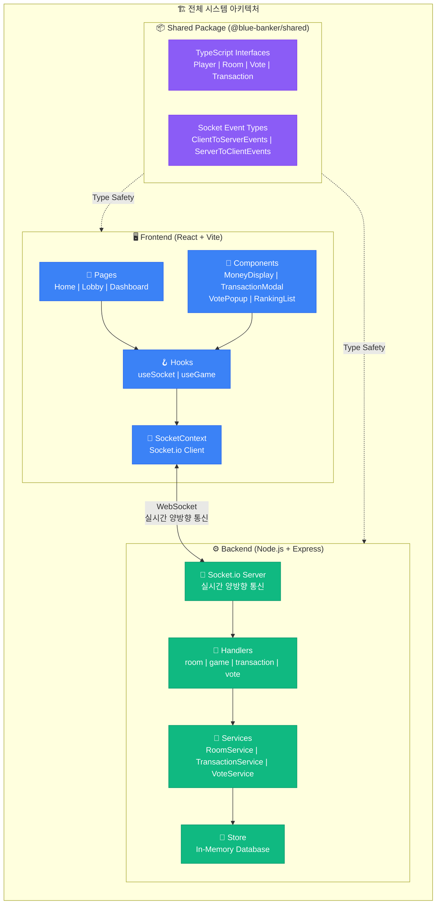
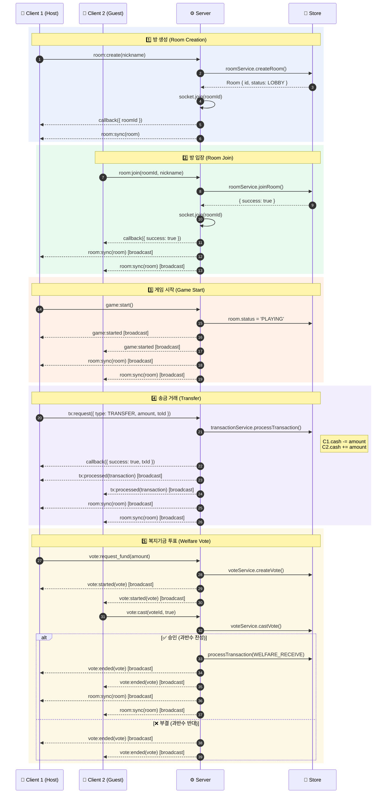
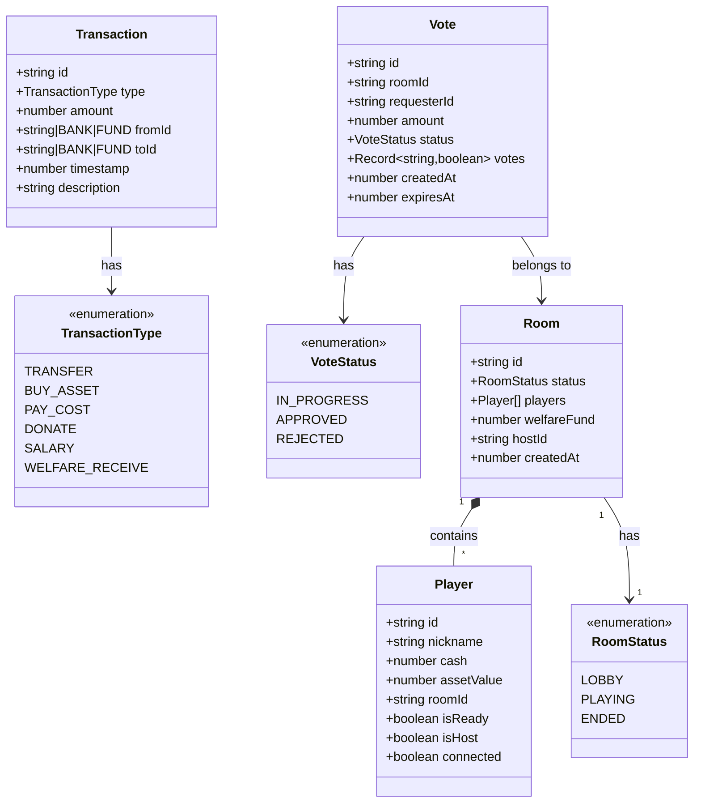
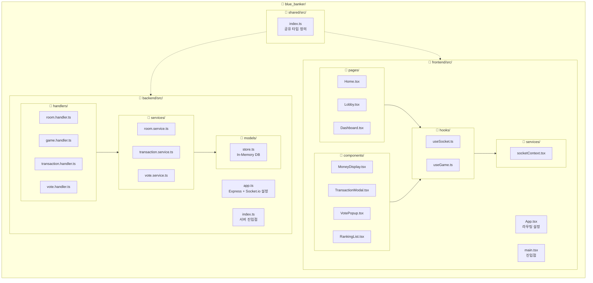

# 🎲 Blue Marble Bank (부루마불 뱅크) - 전체 시스템 로직 순서도

> **프로젝트 개요**: 오프라인 보드게임 부루마불 플레이를 위한 웹 컴패니언 앱
> - **Frontend**: React + Vite + TypeScript + Tailwind CSS
> - **Backend**: Node.js + Express + Socket.io + TypeScript
> - **통신**: Socket.io (실시간 양방향 WebSocket)

---

## 📐 1. 전체 시스템 아키텍처

---

## 🚪 2. 방 생성 및 입장 플로우

```mermaid
flowchart TD
    subgraph ROOM_FLOW["🚪 방 생성 및 입장 플로우"]
        START([🏠 사용자 접속]) --> HOME_PAGE[Home 페이지 렌더링]
        HOME_PAGE --> SOCKET_CONNECT{Socket 연결됨?}
        SOCKET_CONNECT -->|No| WAIT_CONNECT[연결 대기...]
        WAIT_CONNECT --> SOCKET_CONNECT
        SOCKET_CONNECT -->|Yes| INPUT_NICK[닉네임 입력]
        
        INPUT_NICK --> SELECT_MODE{방 생성 or 입장?}
        
        %% 방 생성 플로우
        SELECT_MODE -->|🆕 방 생성| EMIT_CREATE["socket.emit('room:create', nickname)"]
        EMIT_CREATE --> SERVER_CREATE[RoomHandler 수신]
        SERVER_CREATE --> SERVICE_CREATE["roomService.createRoom()"]
        
        subgraph CREATE_ROOM["📝 방 생성 로직"]
            SERVICE_CREATE --> GEN_ROOM_ID["6자리 룸 ID 생성<br/>(중복 체크)"]
            GEN_ROOM_ID --> CREATE_HOST["Host Player 객체 생성<br/>cash: 0, isHost: true"]
            CREATE_HOST --> CREATE_ROOM_OBJ["Room 객체 생성<br/>status: LOBBY"]
            CREATE_ROOM_OBJ --> SAVE_ROOM["store.rooms.set(roomId, room)"]
        end
        
        SAVE_ROOM --> JOIN_SOCKET_ROOM["socket.join(roomId)"]
        JOIN_SOCKET_ROOM --> CALLBACK_CREATE["callback({ roomId })"]
        CALLBACK_CREATE --> EMIT_SYNC_CREATE["socket.emit('room:sync', room)"]
        EMIT_SYNC_CREATE --> NAV_LOBBY_CREATE["navigate('/lobby/{roomId}')"]
        NAV_LOBBY_CREATE --> LOBBY_PAGE[👥 Lobby 페이지]
        
        %% 방 입장 플로우
        SELECT_MODE -->|🚪 방 입장| INPUT_ROOM_CODE[방 코드 입력]
        INPUT_ROOM_CODE --> EMIT_JOIN["socket.emit('room:join', roomId, nickname)"]
        EMIT_JOIN --> SERVER_JOIN[RoomHandler 수신]
        SERVER_JOIN --> SERVICE_JOIN["roomService.joinRoom()"]
        
        subgraph JOIN_ROOM["🔍 방 입장 검증 로직"]
            SERVICE_JOIN --> CHECK_ROOM{방 존재?}
            CHECK_ROOM -->|No| RETURN_ERROR_1["❌ Room not found"]
            CHECK_ROOM -->|Yes| CHECK_STATUS{status === 'LOBBY'?}
            CHECK_STATUS -->|No| RETURN_ERROR_2["❌ Game already started"]
            CHECK_STATUS -->|Yes| CHECK_NICK{닉네임 중복?}
            CHECK_NICK -->|Yes| RETURN_ERROR_3["❌ Nickname taken"]
            CHECK_NICK -->|No| ADD_PLAYER["room.players.push(player)"]
            ADD_PLAYER --> RETURN_SUCCESS["✅ success: true"]
        end
        
        RETURN_ERROR_1 --> SHOW_ERROR[Toast: 에러 메시지]
        RETURN_ERROR_2 --> SHOW_ERROR
        RETURN_ERROR_3 --> SHOW_ERROR
        
        RETURN_SUCCESS --> JOIN_SOCKET_ROOM_2["socket.join(roomId)"]
        JOIN_SOCKET_ROOM_2 --> BROADCAST_SYNC["io.to(roomId).emit('room:sync', room)"]
        BROADCAST_SYNC --> CALLBACK_JOIN["callback({ success: true })"]
        CALLBACK_JOIN --> NAV_LOBBY_JOIN["navigate('/lobby/{roomId}')"]
        NAV_LOBBY_JOIN --> LOBBY_PAGE
        
        LOBBY_PAGE --> END_ROOM([✅ 방 생성/입장 완료])
    end
    
    classDef errorStyle fill:#ef4444,stroke:#dc2626,color:#fff
    classDef successStyle fill:#22c55e,stroke:#16a34a,color:#fff
    classDef processStyle fill:#3b82f6,stroke:#2563eb,color:#fff
    
    class RETURN_ERROR_1,RETURN_ERROR_2,RETURN_ERROR_3,SHOW_ERROR errorStyle
    class RETURN_SUCCESS,END_ROOM,LOBBY_PAGE successStyle
    class GEN_ROOM_ID,CREATE_HOST,CREATE_ROOM_OBJ,SAVE_ROOM,ADD_PLAYER processStyle
```

---

## 🎮 3. 게임 시작 플로우

```mermaid
flowchart TD
    subgraph GAME_START["🎮 게임 시작 플로우"]
        START([👥 Lobby 페이지]) --> CHECK_HOST{현재 사용자가<br/>호스트인가?}
        
        CHECK_HOST -->|No 👤| WAIT_HOST["'호스트가 게임을 시작하기를<br/>기다리고 있습니다...'"]
        WAIT_HOST --> LISTEN_START["game:started 이벤트 대기"]
        
        CHECK_HOST -->|Yes 👑| SHOW_BTN["'게임 시작' 버튼 표시"]
        SHOW_BTN --> CLICK_START{시작 버튼 클릭}
        CLICK_START --> EMIT_START["socket.emit('game:start')"]
        EMIT_START --> TOAST_REQUEST["Toast: '게임 시작 요청!'"]
        
        EMIT_START --> SERVER_START[GameHandler 수신]
        SERVER_START --> FIND_ROOM["호스트인 방 찾기<br/>(store.rooms 순회)"]
        FIND_ROOM --> CHECK_FOUND{방 찾음?}
        
        CHECK_FOUND -->|No| END_INVALID([무시 - 권한 없음])
        CHECK_FOUND -->|Yes| CHECK_STATUS{room.status === 'LOBBY'?}
        CHECK_STATUS -->|No| END_ALREADY([무시 - 이미 시작됨])
        CHECK_STATUS -->|Yes| UPDATE_STATUS["room.status = 'PLAYING'"]
        
        UPDATE_STATUS --> BROADCAST_STARTED["io.to(roomId).emit('game:started')"]
        BROADCAST_STARTED --> BROADCAST_SYNC["io.to(roomId).emit('room:sync', room)"]
        
        LISTEN_START --> CLIENT_STARTED["game:started 수신"]
        BROADCAST_SYNC --> CLIENT_SYNC["room:sync 수신"]
        CLIENT_STARTED --> NAV_GAME["navigate('/game/{roomId}')"]
        CLIENT_SYNC --> CHECK_PLAYING{status === 'PLAYING'?}
        CHECK_PLAYING -->|Yes| NAV_GAME
        CHECK_PLAYING -->|No| STAY_LOBBY[Lobby 유지]
        
        NAV_GAME --> TOAST_SUCCESS["Toast: '게임이 시작되었습니다!'<br/>🔊 playSuccess()"]
        TOAST_SUCCESS --> DASHBOARD([📊 Dashboard 페이지])
    end
    
    classDef hostStyle fill:#f59e0b,stroke:#d97706,color:#fff
    classDef guestStyle fill:#8b5cf6,stroke:#7c3aed,color:#fff
    classDef successStyle fill:#22c55e,stroke:#16a34a,color:#fff
    
    class SHOW_BTN,CLICK_START,EMIT_START hostStyle
    class WAIT_HOST,LISTEN_START guestStyle
    class DASHBOARD,TOAST_SUCCESS successStyle
```

---

## 💰 4. 거래(Transaction) 처리 플로우

```mermaid
flowchart TD
    subgraph TX_FLOW["💰 거래(Transaction) 처리 플로우"]
        START([📊 Dashboard에서 거래 요청]) --> SELECT_TX_TYPE{거래 유형 선택}
        
        %% 거래 유형별 분기
        SELECT_TX_TYPE -->|💸| TX_TRANSFER["TRANSFER<br/>다른 플레이어에게 송금"]
        SELECT_TX_TYPE -->|🏠| TX_BUY["BUY_ASSET<br/>부동산 구매"]
        SELECT_TX_TYPE -->|💳| TX_PAY["PAY_COST<br/>은행에 비용 지불"]
        SELECT_TX_TYPE -->|🤝| TX_DONATE["DONATE<br/>복지기금에 기부"]
        SELECT_TX_TYPE -->|💵| TX_SALARY["SALARY<br/>월급 수령 (20만원)"]
        
        TX_TRANSFER --> OPEN_MODAL[TransactionModal 열기]
        TX_BUY --> OPEN_MODAL
        TX_PAY --> OPEN_MODAL
        TX_DONATE --> OPEN_MODAL
        TX_SALARY --> CONFIRM_SALARY{월급 수령 확인?}
        
        OPEN_MODAL --> INPUT_AMOUNT[💲 금액 입력]
        INPUT_AMOUNT --> INPUT_TARGET{수신자 필요?}
        INPUT_TARGET -->|Yes| SELECT_RECIPIENT[👤 수신자 선택]
        INPUT_TARGET -->|No| SUBMIT_TX
        SELECT_RECIPIENT --> SUBMIT_TX[거래 제출]
        
        CONFIRM_SALARY -->|Yes| EMIT_SALARY["requestTransaction('SALARY', 200000)"]
        CONFIRM_SALARY -->|No| CANCEL([취소])
        
        SUBMIT_TX --> EMIT_TX["socket.emit('tx:request', payload)"]
        EMIT_SALARY --> EMIT_TX
        
        EMIT_TX --> SERVER_TX[TransactionHandler 수신]
        SERVER_TX --> GET_ROOM_ID["getRoomId()<br/>플레이어가 속한 방 찾기"]
        GET_ROOM_ID --> CHECK_ROOM{방 존재?}
        
        CHECK_ROOM -->|No| TX_ERROR_1["❌ Room not found"]
        CHECK_ROOM -->|Yes| SERVICE_TX["transactionService.processTransaction()"]
        
        subgraph PROCESS_TX["⚙️ 거래 처리 로직"]
            SERVICE_TX --> GET_PLAYER[플레이어 조회]
            GET_PLAYER --> CHECK_AMOUNT{금액 > 0?}
            CHECK_AMOUNT -->|No| TX_ERROR_2["❌ Amount must be positive"]
            CHECK_AMOUNT -->|Yes| SWITCH_TYPE{거래 유형 분기}
            
            SWITCH_TYPE -->|TRANSFER| CHECK_RECIPIENT{수신자 존재?}
            CHECK_RECIPIENT -->|No| TX_ERROR_3["❌ Recipient not found"]
            CHECK_RECIPIENT -->|Yes| CHECK_BALANCE_T{잔액 >= 금액?}
            
            SWITCH_TYPE -->|BUY_ASSET| CHECK_BALANCE_B{잔액 >= 금액?}
            SWITCH_TYPE -->|PAY_COST| CHECK_BALANCE_P{잔액 >= 금액?}
            SWITCH_TYPE -->|DONATE| CHECK_BALANCE_D{잔액 >= 금액?}
            SWITCH_TYPE -->|SALARY| EXEC_SALARY["player.cash += amount"]
            
            CHECK_BALANCE_T -->|No| TX_ERROR_4["❌ Insufficient funds"]
            CHECK_BALANCE_B -->|No| TX_ERROR_4
            CHECK_BALANCE_P -->|No| TX_ERROR_4
            CHECK_BALANCE_D -->|No| TX_ERROR_4
            
            CHECK_BALANCE_T -->|Yes| EXEC_TRANSFER["player.cash -= amount<br/>recipient.cash += amount"]
            CHECK_BALANCE_B -->|Yes| EXEC_BUY["player.cash -= amount<br/>player.assetValue += amount"]
            CHECK_BALANCE_P -->|Yes| EXEC_PAY["player.cash -= amount"]
            CHECK_BALANCE_D -->|Yes| EXEC_DONATE["player.cash -= amount<br/>room.welfareFund += amount"]
        end
        
        EXEC_TRANSFER --> CREATE_TX_OBJ["📝 Transaction 객체 생성<br/>id: UUID, timestamp: now"]
        EXEC_BUY --> CREATE_TX_OBJ
        EXEC_PAY --> CREATE_TX_OBJ
        EXEC_DONATE --> CREATE_TX_OBJ
        EXEC_SALARY --> CREATE_TX_OBJ
        
        CREATE_TX_OBJ --> SAVE_TX["store.transactions.set(id, tx)"]
        SAVE_TX --> BROADCAST_TX["io.to(roomId).emit('tx:processed', tx)"]
        BROADCAST_TX --> BROADCAST_SYNC["io.to(roomId).emit('room:sync', room)"]
        BROADCAST_SYNC --> CALLBACK_SUCCESS["callback({ success: true, txId })"]
        
        CALLBACK_SUCCESS --> CLIENT_SUCCESS["✅ Toast: '거래 성공!'<br/>🔊 playSuccess()"]
        
        TX_ERROR_1 --> CALLBACK_ERROR["callback({ success: false, error })"]
        TX_ERROR_2 --> CALLBACK_ERROR
        TX_ERROR_3 --> CALLBACK_ERROR
        TX_ERROR_4 --> CALLBACK_ERROR
        
        CALLBACK_ERROR --> CLIENT_ERROR["❌ Toast: 에러 메시지<br/>🔊 playError()"]
        
        CLIENT_SUCCESS --> END_TX([거래 완료])
        CLIENT_ERROR --> END_TX
    end
    
    classDef errorStyle fill:#ef4444,stroke:#dc2626,color:#fff
    classDef successStyle fill:#22c55e,stroke:#16a34a,color:#fff
    classDef processStyle fill:#3b82f6,stroke:#2563eb,color:#fff
    classDef txTypeStyle fill:#8b5cf6,stroke:#7c3aed,color:#fff
    
    class TX_ERROR_1,TX_ERROR_2,TX_ERROR_3,TX_ERROR_4,CALLBACK_ERROR,CLIENT_ERROR errorStyle
    class CALLBACK_SUCCESS,CLIENT_SUCCESS,END_TX successStyle
    class EXEC_TRANSFER,EXEC_BUY,EXEC_PAY,EXEC_DONATE,EXEC_SALARY processStyle
    class TX_TRANSFER,TX_BUY,TX_PAY,TX_DONATE,TX_SALARY txTypeStyle
```

---

## 🗳️ 5. 복지기금 투표 플로우

```mermaid
flowchart TD
    subgraph VOTE_FLOW["🗳️ 복지기금 투표 플로우"]
        START([📊 복지기금 수령 요청]) --> INPUT_AMOUNT["💲 금액 입력<br/>(prompt 창)"]
        INPUT_AMOUNT --> VALIDATE_INPUT{유효한 금액?}
        
        VALIDATE_INPUT -->|No| ALERT_INVALID["alert('올바른 금액을 입력해주세요')"]
        ALERT_INVALID --> END_INVALID([요청 취소])
        
        VALIDATE_INPUT -->|Yes| EMIT_REQUEST["socket.emit('vote:request_fund', amount)"]
        EMIT_REQUEST --> SERVER_REQUEST[VoteHandler 수신]
        SERVER_REQUEST --> SERVICE_CREATE["voteService.createVote()"]
        
        subgraph CREATE_VOTE["📝 투표 생성 로직"]
            SERVICE_CREATE --> CHECK_FUND{복지기금 >= 요청금액?}
            CHECK_FUND -->|No| VOTE_ERROR_1["❌ Insufficient welfare fund"]
            CHECK_FUND -->|Yes| CHECK_ACTIVE{진행 중인 투표 있음?}
            CHECK_ACTIVE -->|Yes| VOTE_ERROR_2["❌ A vote is already in progress"]
            CHECK_ACTIVE -->|No| CREATE_VOTE_OBJ["Vote 객체 생성<br/>status: IN_PROGRESS"]
            CREATE_VOTE_OBJ --> AUTO_APPROVE["요청자 자동 찬성<br/>vote.votes[requesterId] = true"]
            AUTO_APPROVE --> SAVE_VOTE["store.votes.set(id, vote)"]
        end
        
        VOTE_ERROR_1 --> EMIT_ERROR["socket.emit('error', message)"]
        VOTE_ERROR_2 --> EMIT_ERROR
        EMIT_ERROR --> CLIENT_ERROR["❌ Toast: 에러 메시지"]
        CLIENT_ERROR --> END_ERROR([요청 실패])
        
        SAVE_VOTE --> BROADCAST_STARTED["io.to(roomId).emit('vote:started', vote)"]
        BROADCAST_STARTED --> BROADCAST_UPDATED["io.to(roomId).emit('vote:updated', vote)"]
        BROADCAST_UPDATED --> CLIENT_POPUP["🗳️ 모든 클라이언트에<br/>VotePopup 표시"]
        
        CLIENT_POPUP --> USER_VOTE{사용자 투표}
        USER_VOTE -->|👍 찬성| EMIT_APPROVE["socket.emit('vote:cast', voteId, true)"]
        USER_VOTE -->|👎 반대| EMIT_REJECT["socket.emit('vote:cast', voteId, false)"]
        USER_VOTE -->|⏳ 대기| WAIT_VOTE["다른 사용자 투표 대기"]
        
        EMIT_APPROVE --> SERVER_CAST[VoteHandler: vote:cast 수신]
        EMIT_REJECT --> SERVER_CAST
        
        SERVER_CAST --> SERVICE_CAST["voteService.castVote()"]
        
        subgraph CAST_VOTE["⚖️ 투표 처리 로직"]
            SERVICE_CAST --> CHECK_VOTE_STATUS{status === 'IN_PROGRESS'?}
            CHECK_VOTE_STATUS -->|No| VOTE_ERROR_3["❌ Vote is closed"]
            CHECK_VOTE_STATUS -->|Yes| RECORD_VOTE["vote.votes[voterId] = approve"]
            RECORD_VOTE --> CHECK_OUTCOME["checkVoteOutcome()"]
        end
        
        subgraph OUTCOME_CHECK["📊 투표 결과 판정"]
            CHECK_OUTCOME --> CALC_STATS["totalPlayers, votesCast,<br/>approvals, rejections 계산"]
            CALC_STATS --> CALC_THRESHOLD["threshold = totalPlayers / 2"]
            CALC_THRESHOLD --> CHECK_APPROVE{approvals > threshold?}
            CHECK_APPROVE -->|Yes| FINALIZE_APPROVE["✅ status = 'APPROVED'"]
            CHECK_APPROVE -->|No| CHECK_ALL_VOTED{모두 투표 완료?}
            CHECK_ALL_VOTED -->|Yes| FINALIZE_REJECT["❌ status = 'REJECTED'"]
            CHECK_ALL_VOTED -->|No| CONTINUE["🔄 투표 계속 진행"]
        end
        
        FINALIZE_APPROVE --> EXEC_WELFARE["transactionService.processTransaction()<br/>type: 'WELFARE_RECEIVE'"]
        EXEC_WELFARE --> UPDATE_BALANCES["room.welfareFund -= amount<br/>requester.cash += amount"]
        
        CONTINUE --> EMIT_UPDATED["io.to(roomId).emit('vote:updated', vote)"]
        EMIT_UPDATED --> WAIT_VOTE
        
        UPDATE_BALANCES --> EMIT_ENDED["io.to(roomId).emit('vote:ended', vote)"]
        FINALIZE_REJECT --> EMIT_ENDED
        
        EMIT_ENDED --> EMIT_SYNC["io.to(roomId).emit('room:sync', room)"]
        EMIT_SYNC --> CLIENT_RESULT{투표 결과}
        
        CLIENT_RESULT -->|승인| TOAST_APPROVE["✅ Toast: '투표 승인됨!'<br/>🔊 playSuccess()"]
        CLIENT_RESULT -->|부결| TOAST_REJECT["❌ Toast: '투표 부결됨!'<br/>🔊 playError()"]
        
        TOAST_APPROVE --> CLOSE_POPUP["3초 후 VotePopup 닫기"]
        TOAST_REJECT --> CLOSE_POPUP
        CLOSE_POPUP --> END_SUCCESS([투표 완료])
    end
    
    classDef errorStyle fill:#ef4444,stroke:#dc2626,color:#fff
    classDef successStyle fill:#22c55e,stroke:#16a34a,color:#fff
    classDef processStyle fill:#3b82f6,stroke:#2563eb,color:#fff
    classDef approveStyle fill:#22c55e,stroke:#16a34a,color:#fff
    classDef rejectStyle fill:#f97316,stroke:#ea580c,color:#fff
    
    class VOTE_ERROR_1,VOTE_ERROR_2,VOTE_ERROR_3,CLIENT_ERROR,END_ERROR errorStyle
    class END_SUCCESS,TOAST_APPROVE,UPDATE_BALANCES,EXEC_WELFARE successStyle
    class CREATE_VOTE_OBJ,RECORD_VOTE,CHECK_OUTCOME,CALC_STATS processStyle
    class FINALIZE_APPROVE approveStyle
    class FINALIZE_REJECT,TOAST_REJECT rejectStyle
```

---

## 🔌 6. Socket.io 이벤트 시퀀스 다이어그램

---

## 📊 7. 데이터 모델 (Shared Types)

---

## 📁 8. 프로젝트 디렉토리 구조

---

## 🔑 핵심 포인트 요약

| 영역 | 기술 | 역할 |
|------|------|------|
| **Frontend** | React + Vite | SPA UI 렌더링 |
| **State** | useGame Hook | 게임 상태 관리 및 소켓 이벤트 처리 |
| **통신** | Socket.io | 실시간 양방향 통신 |
| **Backend** | Express + Socket.io | WebSocket 서버 |
| **비즈니스 로직** | Services | 방/거래/투표 처리 |
| **저장소** | In-Memory Store | Map 기반 데이터 저장 |
| **타입 안전성** | Shared Package | 공유 TypeScript 인터페이스 |
