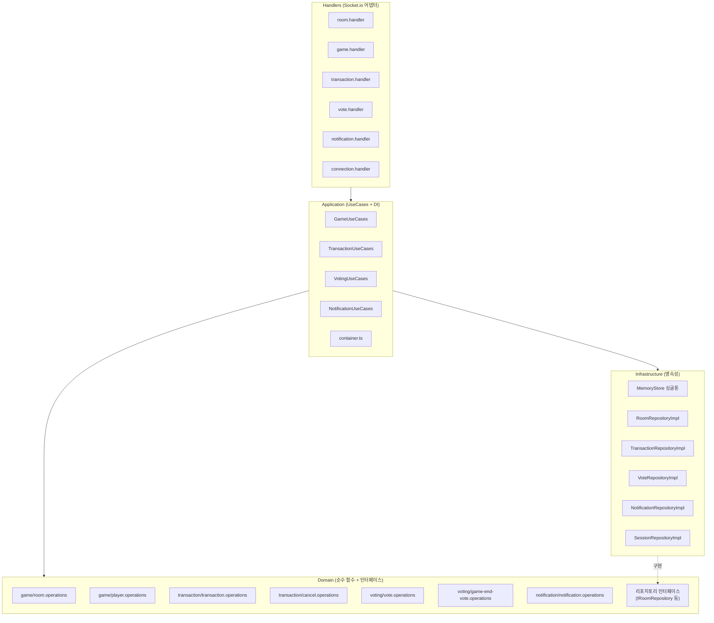
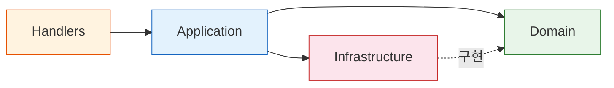
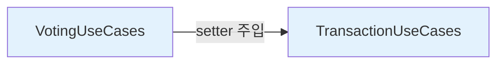

# 백엔드 DDD 아키텍처

> 백엔드는 **Domain-Driven Design(DDD)** 4계층 구조로 설계되어 있다. 도메인 로직은 순수 함수로, 인프라는 교체 가능한 리포지토리로, 핸들러는 얇은 Socket.io 어댑터로 분리된다.

---

## 계층 다이어그램



---

## 의존성 방향 규칙



**핵심 규칙:**
- **Domain** 계층은 외부 의존성이 없다 (순수 함수 + 인터페이스 정의만)
- **Infrastructure**는 Domain의 인터페이스를 **구현**한다
- **Application**은 Domain과 Infrastructure를 조합한다
- **Handlers**는 Application만 의존한다 (Domain/Infrastructure 직접 참조 금지)

---

## Domain 계층

순수 함수와 리포지토리 인터페이스로 구성된다. 외부 의존성이 없어 단위 테스트가 용이하다.

### 도메인 모듈

| 도메인 | 파일 | 역할 |
|--------|------|------|
| **game** | `room.operations.ts` | 방 생성, 참여, 상태 전환, 호스트 마이그레이션 |
| | `player.operations.ts` | 플레이어 생성, 현금/자산 변경, 연결 상태 관리 |
| | `room.repository.ts` | `IRoomRepository` 인터페이스 |
| | `session.repository.ts` | `ISessionRepository` 인터페이스 |
| **transaction** | `transaction.operations.ts` | 거래 생성, 금액 계산, 자산 매매 로직 |
| | `cancel.operations.ts` | 거래 취소 요청/승인/거절 로직 |
| | `transaction.repository.ts` | `ITransactionRepository` 인터페이스 |
| **voting** | `vote.operations.ts` | 복지기금/은행수령 투표 생성, 캐스팅, 결과 판정 |
| | `game-end-vote.operations.ts` | 게임 종료 투표 생성, 캐스팅, 취소 |
| | `vote.repository.ts` | `IVoteRepository` 인터페이스 |
| **notification** | `notification.operations.ts` | 알림 생성, 읽음 처리 |
| | `notification.repository.ts` | `INotificationRepository` 인터페이스 |

### Companion Module 패턴

클래스 래핑 대신 **plain object + 순수 함수** 조합을 사용한다:

```typescript
// room.operations.ts — 순수 함수로 로직 표현
export function createRoom(hostId: string, nickname: string): Room {
  return {
    id: generateRoomId(),
    status: 'LOBBY',
    players: [createPlayer(hostId, nickname, true)],
    welfareFund: 0,
    hostId,
    createdAt: Date.now(),
  };
}
```

---

## Infrastructure 계층

### MemoryStore (싱글톤)

모든 인메모리 데이터를 보유하는 중앙 저장소. **7개 주요 Map + 4개 보조 인덱스**로 구성된다.

| Map | 키 | 값 | 용도 |
|-----|-----|-----|------|
| `rooms` | roomId | Room | 게임 방 |
| `transactions` | txId | Transaction | 거래 기록 |
| `votes` | voteId | Vote | 일반 투표 (복지기금, 은행수령) |
| `gameEndVotes` | voteId | GameEndVote | 게임 종료 투표 |
| `disconnectedSessions` | sessionKey | DisconnectedSession | 재연결 세션 |
| `notifications` | notifId | Notification | 알림 |
| `cancelRequests` | cancelId | CancelRequest | 거래 취소 요청 |

| 인덱스 | 키 → 값 | 용도 |
|--------|---------|------|
| `playerToRoom` | playerId → roomId | 플레이어의 현재 방 조회 |
| `roomTransactions` | roomId → Set\<txId\> | 방의 모든 거래 조회 |
| `playerNotifications` | playerId → Set\<notifId\> | 플레이어 알림 조회 |
| `roomCreatorIps` | roomId → creatorIp | IP 기반 방 생성 제한 |

### 리포지토리 구현체

각 도메인의 인터페이스를 구현하며, MemoryStore를 주입받는다:

```
infrastructure/persistence/
├── memory-store.ts                 # MemoryStore 싱글톤
├── room.repository.impl.ts        # IRoomRepository 구현
├── session.repository.impl.ts     # ISessionRepository 구현
├── transaction.repository.impl.ts # ITransactionRepository 구현
├── vote.repository.impl.ts        # IVoteRepository 구현
└── notification.repository.impl.ts # INotificationRepository 구현
```

---

## Application 계층

### 4개 UseCases

| 클래스 | 주입받는 리포지토리 | 역할 |
|--------|-----------------|------|
| `GameUseCases` | IRoomRepository, ISessionRepository | 방 CRUD, 게임 시작/종료, 세션 복구 |
| `TransactionUseCases` | ITransactionRepository | 거래 처리, 취소 요청/승인 |
| `VotingUseCases` | IVoteRepository | 투표 생성, 캐스팅, 결과 처리 |
| `NotificationUseCases` | INotificationRepository | 알림 CRUD, 읽음 처리 |

### container.ts (수동 DI)

> 참조: `backend/src/application/container.ts`

```typescript
// 리포지토리 인스턴스 생성
const roomRepo = new RoomRepositoryImpl(memoryStore);
const transactionRepo = new TransactionRepositoryImpl(memoryStore);
// ...

// UseCases 인스턴스 생성 및 export
export const gameUseCases = new GameUseCases(roomRepo, sessionRepo, cleanupRoom);
export const transactionUseCases = new TransactionUseCases(transactionRepo);
export const votingUseCases = new VotingUseCases(voteRepo);
export const notificationUseCases = new NotificationUseCases(notificationRepo);

// 순환 의존 해결: VotingUseCases → TransactionUseCases
votingUseCases.setTransactionUseCases(transactionUseCases);
```

### 순환 의존 해결

`VotingUseCases`는 투표 승인 시 `TransactionUseCases`를 호출해야 한다. 생성자 주입으로는 순환이 발생하므로 **setter 주입**으로 해결한다:



---

## Handlers 계층

Socket.io 이벤트를 받아 UseCases에 위임하는 **얇은 어댑터**. 비즈니스 로직을 포함하지 않는다.

| 핸들러 | 담당 이벤트 네임스페이스 | 주입받는 UseCases |
|--------|----------------------|-----------------|
| `room.handler.ts` | room:*, asset:* | gameUseCases |
| `game.handler.ts` | game:*, game_end_vote:* | gameUseCases, votingUseCases |
| `transaction.handler.ts` | tx:*, transaction:* | transactionUseCases, gameUseCases |
| `vote.handler.ts` | vote:*, bank_receive_vote:* | votingUseCases, transactionUseCases |
| `notification.handler.ts` | notification:* | notificationUseCases |
| `connection.handler.ts` | disconnect, player:kick | gameUseCases |

핸들러의 책임:
1. 입력 검증 (`validate()`)
2. Rate Limiting 체크 (`rateLimiter.checkLimit()`)
3. 권한 확인 (`isRoomHost()`, `isRoomMember()`)
4. UseCases 호출
5. Socket.io emit/broadcast

---

## Utils

| 파일 | 역할 |
|------|------|
| `constants.ts` | 타임아웃, 제한값, Rate Limit 설정 등 모든 상수 |
| `helpers.ts` | `formatManwon`, `getClientIp`, `isRoomMember`, `isRoomHost` |
| `timer-manager.ts` | Key 기반 타이머 관리 싱글톤 (중복 방지, prefix 정리) |
| `rate-limiter.ts` | Fixed-window Rate Limiter (5개 유형) |
| `validation.ts` | Zod 스키마 기반 소켓 이벤트 payload 검증 |

---

## Shared 패키지

`shared/src/index.ts`에 프론트엔드/백엔드 공유 타입이 정의된다:

- **인터페이스**: Player, Room, Asset, Transaction, Vote, GameEndVote, CancelRequest, Notification 등
- **열거형**: RoomStatus, ConnectionStatus, TransactionType, VoteType 등
- **이벤트 타입**: `ServerToClientEvents`, `ClientToServerEvents` (타입 안전한 Socket.io)
- **payload 타입**: ConnectionStatusPayload, GameEndedPayload 등

자세한 내용은 [data-model.md](./data-model.md)를 참고한다.
