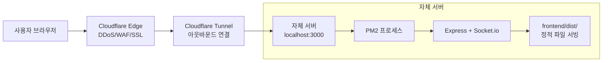
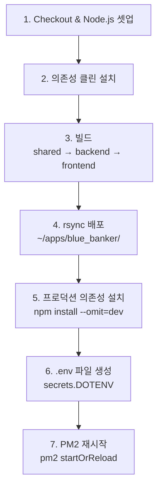

# 배포 및 운영

> Cloudflare Tunnel + GitHub Actions + PM2 기반 배포 파이프라인과 운영 가이드.

참조: [`docs/cloudflare-tunnel-domain-protection.md`](../docs/cloudflare-tunnel-domain-protection.md)

---

## 배포 아키텍처 개요



**핵심 이점:**
- 서버 포트 포워딩 불필요 (Tunnel이 아웃바운드 연결)
- 오리진 IP 완벽 은닉
- Same-Origin이므로 CORS 불필요
- Cloudflare 무료 플랜: DDoS, WAF, SSL, Bot Fight Mode

---

## GitHub Actions 파이프라인

> 참조: [`.github/workflows/deploy.yml`](../.github/workflows/deploy.yml)

### 트리거 조건

`master` 브랜치에 `backend/`, `frontend/`, `shared/`, `.github/workflows/` 변경이 push되면 실행.

### 파이프라인 단계 (7단계)



| 단계 | 설명 |
|------|------|
| 1. Checkout | `actions/checkout@v4` + Node.js LTS 설정 |
| 2. 클린 설치 | 기존 `node_modules`, `package-lock.json` 삭제 후 재설치 |
| 3. 빌드 | `shared → backend → frontend` 순서로 빌드 |
| 4. rsync 배포 | `~/apps/blue_banker/`로 파일 동기화 (.git, node_modules 제외) |
| 5. 의존성 | `--omit=dev`로 프로덕션 의존성만 설치 |
| 6. .env | `secrets.DOTENV` → `.env` 파일 생성 (600 권한) |
| 7. PM2 | `pm2 startOrReload ecosystem.config.js --update-env` |

**Self-Hosted Runner** 사용 — GitHub 제공 호스팅이 아닌 자체 서버에서 실행.

---

## PM2 운영

> 참조: [`ecosystem.config.js`](../ecosystem.config.js)

### PM2 설정

```javascript
{
  name: "blue-banker-backend",
  cwd: "./backend",
  script: "./dist/index.js",
  instances: 1,
  autorestart: true,
  watch: false,
  env: {
    NODE_ENV: "production",
    PORT: 3000
  }
}
```

### 주요 운영 명령어

```bash
# 상태 확인
pm2 status

# 로그 확인 (실시간)
pm2 logs blue-banker-backend

# 재시작
pm2 restart blue-banker-backend

# 설정 리로드 (무중단)
pm2 startOrReload ecosystem.config.js --update-env

# 프로세스 중단
pm2 stop blue-banker-backend

# PM2 프로세스 목록 저장 (서버 재부팅 후 자동 복구)
pm2 save
```

---

## Cloudflare Tunnel 운영

### 터널 상태 확인

```bash
# 터널 실행 상태 확인
cloudflared tunnel info <TUNNEL_NAME>

# 서비스 로그 확인
journalctl -u cloudflared -f
```

### Cloudflare 보안 설정

| 설정 | 값 | 효과 |
|------|-----|------|
| SSL/TLS | Full (Strict) | 종단간 암호화 |
| WAF | 활성화 | 웹 애플리케이션 방화벽 |
| Bot Fight Mode | 활성화 | 봇 트래픽 차단 |
| DDoS | 자동 | L3/L4/L7 DDoS 방어 |

---

## Health Check / Keep-alive

### Health 엔드포인트

```
GET /health → 200 OK
```

### Keep-alive

Cron-job.org 연동으로 주기적으로 health 엔드포인트를 호출하여 서버를 깨워둔다.

---

## 트러블슈팅 체크리스트

### 서버 접속 불가

1. PM2 프로세스 상태 확인: `pm2 status`
2. 포트 사용 확인: `lsof -i :3000`
3. Cloudflare Tunnel 상태 확인: `cloudflared tunnel info`
4. 서버 로그 확인: `pm2 logs blue-banker-backend --lines 50`

### 배포 실패

1. GitHub Actions 로그 확인
2. Self-Hosted Runner 상태 확인
3. 빌드 에러: shared 먼저 빌드했는지 확인
4. rsync 권한: 배포 디렉토리 소유자 확인

### WebSocket 연결 실패

1. Cloudflare Tunnel이 WebSocket을 지원하는지 확인 (기본 지원)
2. CORS 설정 확인 (프로덕션: Same-Origin, 개발: 사설 IP 허용)
3. Socket.io 버전 호환성 확인 (클라이언트/서버 동일 메이저 버전)

### 메모리 사용량 증가

1. 오래된 방 자동 정리 확인 (`MAX_ROOM_AGE_MS`: 24시간)
2. 만료된 세션 정리 확인 (`SESSION_CLEANUP_INTERVAL_MS`: 1분)
3. Rate Limiter 레코드 정리 확인
4. PM2 메모리 모니터링: `pm2 monit`

---

## 참조

- [`docs/cloudflare-tunnel-domain-protection.md`](../docs/cloudflare-tunnel-domain-protection.md) — Cloudflare Tunnel 상세 설정
- [`.github/workflows/deploy.yml`](../.github/workflows/deploy.yml) — CI/CD 파이프라인
- [`ecosystem.config.js`](../ecosystem.config.js) — PM2 설정
