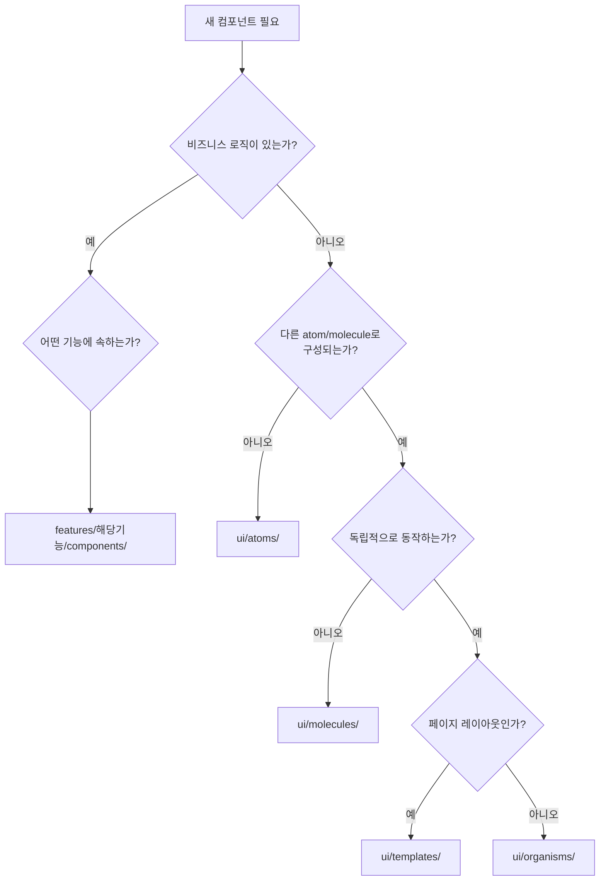

# 프론트엔드 Atomic Design 아키텍처

> 프론트엔드는 **Atomic Design + Feature 기반 혼합 구조**를 사용한다. `ui/` 계층은 순수 UI 컴포넌트, `features/` 계층은 비즈니스 로직을 포함한 기능 모듈로 분리된다.

참조: [`docs/ui-tool-integration.md`](../docs/ui-tool-integration.md)

---

## ui/ vs features/ 분리 기준

| 기준 | `ui/` (Atomic Design) | `features/` (비즈니스 모듈) |
|------|----------------------|--------------------------|
| **비즈니스 로직** | 금지 | 허용 |
| **Socket.io 의존** | 금지 | 허용 |
| **재사용성** | 높음 (범용) | 낮음 (기능 특화) |
| **상태 관리** | props만 (외부 제어) | 내부 상태 + hooks 사용 |
| **외부 도구 산출물** | 여기에 배치 (v0.dev 등) | 직접 배치 안 함 |

---

## 디렉토리 구조

```
frontend/src/
├── ui/                          # Atomic Design 계층
│   ├── atoms/                   # 최소 단위 UI 컴포넌트
│   ├── molecules/               # atom 조합
│   ├── organisms/               # 독립 기능 블록
│   ├── templates/               # 페이지 레이아웃 뼈대
│   └── index.ts                 # barrel export
│
├── features/                    # 비즈니스 로직 모듈
│   ├── transaction/             # 거래 기능
│   ├── ranking/                 # 순위 기능
│   ├── vote/                    # 투표 기능
│   └── index.ts                 # barrel export
│
├── pages/                       # 라우트 엔트리포인트
│   ├── Home.tsx
│   ├── Lobby.tsx
│   └── Dashboard.tsx
│
├── hooks/                       # 커스텀 훅
├── contexts/                    # React Context
├── services/                    # 소켓 컨텍스트
├── components/                  # 미분류 컴포넌트 (레거시)
└── utils/                       # 유틸리티 함수
```

---

## Atomic Design 계층

### atoms/ — 최소 단위 UI

순수 UI 빌딩 블록. **상태를 가지지 않으며**, props로만 제어된다.

| 컴포넌트 | 역할 | 주요 Props |
|---------|------|-----------|
| `BaseButton` | 버튼 | `variant`(primary/secondary/danger/ghost/success), `size`(sm/md/lg), `fullWidth` |
| `TextInput` | 입력 필드 | `type`, `placeholder`, `rightAdornment` |
| `StatusDot` | 연결 상태 표시 | `status`(ONLINE/OFFLINE/RECONNECTING), `size`, `showLabel` |
| `IconText` | 아이콘+텍스트 레이아웃 | `icon`, `text` |
| `ModalBackdrop` | 모달 배경 오버레이 | `children`, `onClick` |

### molecules/ — atom 조합

atoms를 조합하여 의미 있는 단위를 구성한다.

| 컴포넌트 | 구성 | 역할 |
|---------|------|------|
| `MoneyDisplay` | 금액 텍스트 + 토글 | 만원/원 형식 전환 가능한 금액 표시 |
| `ModalHeader` | 제목 텍스트 + BaseButton(닫기) | 모달 상단 헤더 |
| `AmountField` | TextInput + "원" 어도른먼트 | 금액 입력 필드 |
| `PlayerRow` | StatusDot + 닉네임 + 자산 정보 | 플레이어 정보 행 |
| `VoteTimer` | 타이머 텍스트 | 투표 남은 시간 카운트다운 |

### organisms/ — 독립 기능 블록

molecules를 조합하여 독립적으로 동작하는 기능 블록을 구성한다.

| 컴포넌트 | 역할 |
|---------|------|
| `QuickActionGrid` | 2x2 액션 그리드 (송금, 매입, 기부, 월급) |
| `TransactionForm` | 거래 폼 (금액 입력, 유형 선택, 대상 선택) |
| `VotePanel` | 투표 진행률 + 찬반 버튼 |

### templates/ — 페이지 레이아웃

각 페이지의 레이아웃 뼈대를 정의한다. 콘텐츠는 children으로 주입된다.

| 컴포넌트 | 사용 페이지 | 레이아웃 특징 |
|---------|-----------|-------------|
| `HomeTemplate` | Home | 그라데이션 배경, 중앙 카드 |
| `LobbyTemplate` | Lobby | 상단 헤더, 중앙 콘텐츠, 하단 버튼 |
| `DashboardTemplate` | Dashboard | 상단 네비게이션, 스크롤 메인, 하단 여유 |

---

## features/ 계층

비즈니스 로직을 포함하는 기능 모듈. Socket.io 이벤트, useGame 훅과 직접 상호작용한다.

### transaction/

| 컴포넌트 | 역할 |
|---------|------|
| `TransactionModal` | 거래 요청 모달 (TRANSFER, BUY_ASSET, DONATE, SALARY) |
| `TransactionHistory` | 거래 내역 조회 + 취소 요청 |
| `ConfirmModal` | 확인 모달 (월급, 복지기금, 게임 종료) |

### vote/

| 컴포넌트 | 역할 |
|---------|------|
| `VotePopup` | 기본 투표 팝업 |
| `WelfareFundVotePopup` | 복지기금 투표 (금액 표시, 타이머) |
| `GameEndVotePopup` | 게임 종료 투표 (취소 버튼, 전원 동의) |
| `BankReceiveVotePopup` | 은행 수령 투표 (요청자, 사유 표시) |

### ranking/

| 컴포넌트 | 역할 |
|---------|------|
| `RankingList` | 실시간 순위 목록 (메달, 연결 상태, 자산 통계) |
| `PlayerAssetModal` | 플레이어 자산 상세 + 자산명 수정 |
| `KickPlayerButton` | 호스트 전용 강제 퇴장 버튼 |

---

## pages/ — 라우트 엔트리포인트

| 페이지 | 경로 | 역할 |
|--------|------|------|
| `Home` | `/` | 방 생성/입장 UI |
| `Lobby` | `/lobby/:roomId` | 게임 대기실, 호스트가 게임 시작 |
| `Dashboard` | `/game/:roomId` | 게임 진행 화면 (거래, 투표, 순위) |

---

## Barrel Export 패턴

각 계층은 `index.ts`를 통해 공개 API를 정의한다:

```typescript
// ui/index.ts — 전체 UI 컴포넌트 내보냄
export * from './atoms';
export * from './molecules';
export * from './organisms';
export * from './templates';

// features/index.ts — 전체 feature 모듈 내보냄
export * from './transaction';
export * from './vote';
export * from './ranking';
```

사용 시:

```typescript
import { BaseButton, MoneyDisplay, QuickActionGrid } from '../ui';
import { TransactionModal, VotePopup, RankingList } from '../features';
```

---

## 새 컴포넌트 배치 판단 플로우차트



### 배치 판단 기준 요약

1. **Socket.io/useGame 의존** → `features/`
2. **순수 UI, 상태 없음, 최소 단위** → `ui/atoms/`
3. **atom 2개 이상 조합, 상태 없음** → `ui/molecules/`
4. **독립 기능 블록 (organism 스스로 의미 있음)** → `ui/organisms/`
5. **페이지 전체 레이아웃 뼈대** → `ui/templates/`

---

## 참조

- [`docs/ui-tool-integration.md`](../docs/ui-tool-integration.md) — v0.dev 등 외부 UI 도구 통합 가이드
- [state-management.md](./state-management.md) — useGame 훅 및 Context 상세
