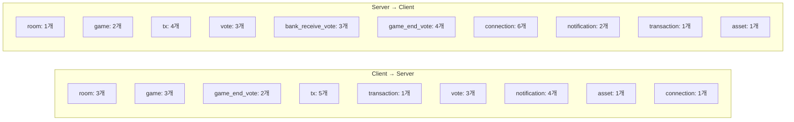

# 소켓 이벤트 전체 레퍼런스

> Client↔Server 간 Socket.io 이벤트 전체 목록. 파라미터, payload 타입, 권한 요구사항, broadcast/unicast 여부를 정리한다.

타입 정의: [`shared/src/index.ts`](../shared/src/index.ts)

---

## 콜백 응답 패턴

모든 콜백 응답은 다음 패턴 중 하나를 따른다:

```typescript
// 패턴 1: 성공/실패 + 메시지
{ success: boolean; message?: string }

// 패턴 2: 성공 + ID
{ success: boolean; txId?: string; error?: string }
{ success: boolean; voteId?: string; error?: string }

// 패턴 3: 데이터 반환
Transaction[] | Notification[] | number

// 패턴 4: 방 정보 반환
{ room?: Room; error?: string }
{ success: boolean; room?: Room; message?: string }
```

---

## Client → Server 이벤트 (22개)

### room 네임스페이스

| 이벤트 | 파라미터 | 콜백 응답 | 권한 | Rate Limit | 핸들러 |
|--------|---------|----------|------|-----------|--------|
| `room:create` | `nickname: string` | `{ roomId }` | 없음 | ROOM_CREATE (5/5분, IP) | room.handler |
| `room:join` | `roomId, nickname` | `{ success, message?, room? }` | 없음 | ROOM_JOIN (20/분, IP) | room.handler |
| `room:get` | `roomId: string` | `{ room?, error? }` | 없음 | 없음 | room.handler |

### game 네임스페이스

| 이벤트 | 파라미터 | 콜백 응답 | 권한 | Rate Limit | 핸들러 |
|--------|---------|----------|------|-----------|--------|
| `game:start` | `initialCash: number` | 없음 | **호스트** | GENERAL | game.handler |
| `game:end` | `roomId: string` | 없음 | **호스트** | 없음 | game.handler |
| `game:request_end` | `roomId: string` | `{ success, error?, voteId? }` | **호스트** | 없음 | game.handler |

### game_end_vote 네임스페이스

| 이벤트 | 파라미터 | 콜백 응답 | 권한 | Rate Limit | 핸들러 |
|--------|---------|----------|------|-----------|--------|
| `game_end_vote:cast` | `voteId, approve` | `{ success, error? }` | 방 멤버 | VOTE (30/분) | game.handler |
| `game_end_vote:cancel` | `voteId: string` | `{ success, error? }` | **호스트** | GENERAL | game.handler |

### tx 네임스페이스

| 이벤트 | 파라미터 | 콜백 응답 | 권한 | Rate Limit | 핸들러 |
|--------|---------|----------|------|-----------|--------|
| `tx:request` | `{ type, amount, toId?, assetType?, buildingType? }` | `{ success, txId?, error? }` | 방 멤버 | TRANSACTION (60/분) | transaction.handler |
| `tx:bank_receive` | `{ targetPlayerId, amount, reason, customReason? }` | `{ success, message? }` | **호스트** | TRANSACTION | transaction.handler |
| `tx:sell_asset` | `{ assetId, bundleSell? }` | `{ success, message?, receivedAmount? }` | 방 멤버 | TRANSACTION | transaction.handler |
| `tx:request_cancel` | `transactionId: string` | `{ success, error?, requestId? }` | 거래 당사자 | TRANSACTION | transaction.handler |
| `tx:respond_cancel` | `requestId, approve` | `{ success, error? }` | 거래 상대방 | TRANSACTION | transaction.handler |

### transaction 네임스페이스

| 이벤트 | 파라미터 | 콜백 응답 | 권한 | Rate Limit | 핸들러 |
|--------|---------|----------|------|-----------|--------|
| `transaction:get_history` | 없음 | `Transaction[]` | 없음 | 없음 | transaction.handler |

### vote 네임스페이스

| 이벤트 | 파라미터 | 콜백 응답 | 권한 | Rate Limit | 핸들러 |
|--------|---------|----------|------|-----------|--------|
| `vote:request_fund` | `amount: number` | 없음 | 방 멤버 | VOTE (30/분) | vote.handler |
| `vote:cast` | `voteId, approve` | 없음 | 방 멤버 | VOTE (30/분) | vote.handler |
| `vote:request_bank_receive` | `{ amount, reason, customReason? }` | `{ success, error?, voteId? }` | 방 멤버 | VOTE (30/분) | vote.handler |

### notification 네임스페이스

| 이벤트 | 파라미터 | 콜백 응답 | 권한 | Rate Limit | 핸들러 |
|--------|---------|----------|------|-----------|--------|
| `notification:mark_read` | `notificationId` | `{ success }` | 본인 알림만 | 없음 | notification.handler |
| `notification:mark_all_read` | 없음 | `{ success, count? }` | 본인 알림만 | 없음 | notification.handler |
| `notification:get_list` | 없음 | `Notification[]` | 본인 알림만 | 없음 | notification.handler |
| `notification:get_unread_count` | 없음 | `number` | 본인 알림만 | 없음 | notification.handler |

### asset 네임스페이스

| 이벤트 | 파라미터 | 콜백 응답 | 권한 | Rate Limit | 핸들러 |
|--------|---------|----------|------|-----------|--------|
| `asset:rename` | `assetId, newName` | `{ success, error? }` | 방 멤버 | GENERAL | room.handler |

### connection 네임스페이스

| 이벤트 | 파라미터 | 콜백 응답 | 권한 | Rate Limit | 핸들러 |
|--------|---------|----------|------|-----------|--------|
| `player:kick` | `playerId: string` | `{ success, message? }` | **호스트** | GENERAL | connection.handler |

---

## Server → Client 이벤트 (26개)

### room 네임스페이스

| 이벤트 | Payload | Broadcast/Unicast | 설명 |
|--------|---------|------------------|------|
| `room:sync` | `Room` | Broadcast (방 전체) | 방 상태 동기화 (플레이어 변경 시마다) |

### game 네임스페이스

| 이벤트 | Payload | Broadcast/Unicast | 설명 |
|--------|---------|------------------|------|
| `game:started` | 없음 | Broadcast | 게임 시작 알림 |
| `game:ended` | `GameEndedPayload` | Broadcast | 게임 종료 + 순위 정보 |

### tx 네임스페이스

| 이벤트 | Payload | Broadcast/Unicast | 설명 |
|--------|---------|------------------|------|
| `tx:processed` | `Transaction` | Broadcast | 거래 처리 완료 |
| `tx:cancel_requested` | `CancelRequest` | Unicast (상대방) | 거래 취소 요청 수신 |
| `tx:cancel_responded` | `CancelRequest` | Unicast (요청자) | 거래 취소 응답 수신 |
| `tx:cancelled` | `Transaction` | Broadcast | 거래 취소 완료 |

### vote 네임스페이스

| 이벤트 | Payload | Broadcast/Unicast | 설명 |
|--------|---------|------------------|------|
| `vote:started` | `Vote` | Broadcast | 복지기금 투표 시작 |
| `vote:updated` | `Vote` | Broadcast | 복지기금 투표 진행 상황 |
| `vote:ended` | `Vote` | Broadcast | 복지기금 투표 종료 |

### bank_receive_vote 네임스페이스

| 이벤트 | Payload | Broadcast/Unicast | 설명 |
|--------|---------|------------------|------|
| `bank_receive_vote:started` | `Vote` | Broadcast | 은행 수령 투표 시작 |
| `bank_receive_vote:updated` | `Vote` | Broadcast | 은행 수령 투표 진행 |
| `bank_receive_vote:ended` | `Vote` | Broadcast | 은행 수령 투표 종료 |

### game_end_vote 네임스페이스

| 이벤트 | Payload | Broadcast/Unicast | 설명 |
|--------|---------|------------------|------|
| `game_end_vote:started` | `GameEndVote` | Broadcast | 게임 종료 투표 시작 |
| `game_end_vote:updated` | `GameEndVote` | Broadcast | 게임 종료 투표 진행 |
| `game_end_vote:ended` | `GameEndVote` | Broadcast | 게임 종료 투표 종료 |
| `game_end_vote:cancelled` | `{ voteId, cancelledBy }` | Broadcast | 게임 종료 투표 취소 |

### connection 네임스페이스

| 이벤트 | Payload | Broadcast/Unicast | 설명 |
|--------|---------|------------------|------|
| `connection:status` | `ConnectionStatusPayload` | Broadcast | 플레이어 연결 상태 변경 |
| `host:migrating` | `HostMigratingPayload` | Broadcast | 호스트 마이그레이션 시작 (120초) |
| `host:migrated` | `HostMigratedPayload` | Broadcast | 호스트 마이그레이션 완료 |
| `host:migration_cancelled` | `{ hostId, hostNickname }` | Broadcast | 호스트 복귀로 마이그레이션 취소 |
| `player:kicked` | `PlayerKickedPayload` | Broadcast | 플레이어 강제 퇴장 |
| `player:rejoined` | `{ playerId, nickname }` | Broadcast | 플레이어 재입장 |

### notification 네임스페이스

| 이벤트 | Payload | Broadcast/Unicast | 설명 |
|--------|---------|------------------|------|
| `notification:received` | `Notification` | Unicast (대상자) | 새 알림 수신 |
| `notification:count` | `number` | Unicast (대상자) | 미읽 알림 수 갱신 |

### transaction 네임스페이스

| 이벤트 | Payload | Broadcast/Unicast | 설명 |
|--------|---------|------------------|------|
| `transaction:history` | `Transaction[]` | Unicast (요청자) | 거래 내역 반환 |

### asset 네임스페이스

| 이벤트 | Payload | Broadcast/Unicast | 설명 |
|--------|---------|------------------|------|
| `asset:renamed` | `{ playerId, assetId, oldName, newName }` | Broadcast | 자산명 변경 알림 |

### error

| 이벤트 | Payload | Broadcast/Unicast | 설명 |
|--------|---------|------------------|------|
| `error` | `string` | Unicast (해당 클라이언트) | 에러 메시지 |

---

## 네임스페이스별 이벤트 요약



---

## 참조

- [`shared/src/index.ts`](../shared/src/index.ts) — `ClientToServerEvents`, `ServerToClientEvents` 타입 정의
- [`backend/src/handlers/`](../backend/src/handlers/) — 핸들러 구현체
- [data-model.md](./data-model.md) — payload 타입 상세
