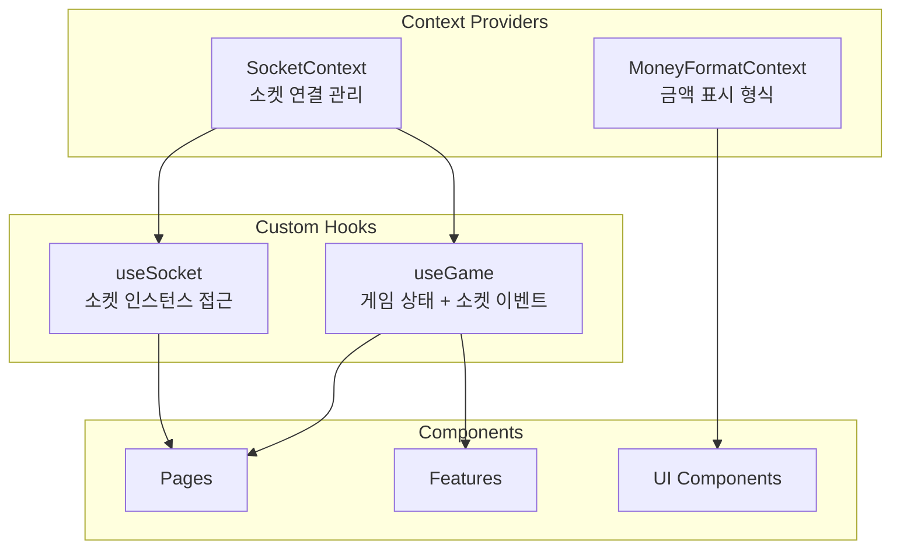
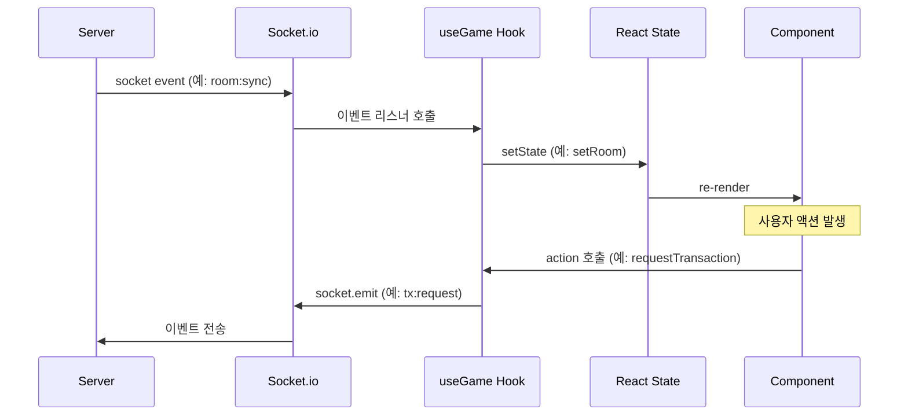
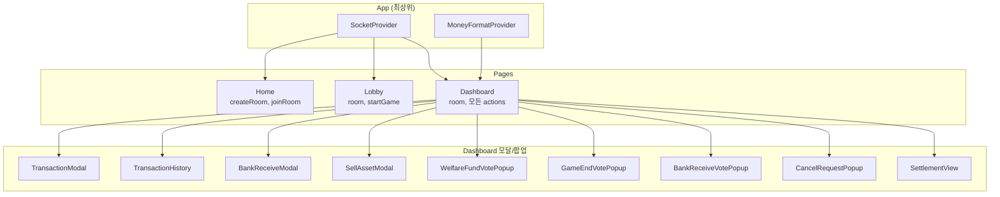

# 프론트엔드 상태 관리

> 프론트엔드는 **Context + Custom Hooks** 패턴으로 상태를 관리한다. Redux 같은 외부 상태 관리 라이브러리를 사용하지 않는다.

---

## 상태 관리 전략



---

## SocketContext

> 파일: [`frontend/src/services/socketContext.tsx`](../frontend/src/services/socketContext.tsx)

Socket.io 연결을 생성하고 관리하는 Context.

### 제공 상태

| 상태 | 타입 | 설명 |
|------|------|------|
| `socket` | `AppSocket \| null` | Socket.io 클라이언트 인스턴스 |
| `connected` | `boolean` | 연결 상태 |
| `reconnecting` | `boolean` | 재연결 시도 중 |
| `reconnectAttempt` | `number` | 현재 재연결 시도 횟수 |
| `reconnectFailed` | `boolean` | 재연결 최종 실패 |

### 연결 설정

```typescript
// 프로덕션: Same-Origin (현재 도메인으로 연결)
// 개발: VITE_BACKEND_URL 환경변수 또는 호스트 IP:15645
```

### 재연결 정책

| 설정 | 값 |
|------|-----|
| `reconnection` | `true` |
| `reconnectionAttempts` | 5 |
| `reconnectionDelay` | 2,000ms (시작) |
| `reconnectionDelayMax` | 32,000ms (지수 백오프) |

### 이벤트 처리

- `connect` → `connected: true`, `reconnecting: false`
- `disconnect` → `connected: false`
- `reconnect_attempt` → `reconnecting: true`, `reconnectAttempt++`
- `reconnect` → `connected: true`, `reconnecting: false`
- `reconnect_failed` → `reconnectFailed: true`

---

## MoneyFormatContext

> 파일: [`frontend/src/contexts/MoneyFormatContext.tsx`](../frontend/src/contexts/MoneyFormatContext.tsx)

금액 표시 형식(만원/원)을 전역으로 토글하는 Context.

| 상태/함수 | 타입 | 설명 |
|----------|------|------|
| `useManwon` | `boolean` | `true`: 만원 형식, `false`: 원 형식 |
| `toggleFormat()` | `() => void` | 형식 전환 |

사용처: `MoneyDisplay` 컴포넌트 (clickable=true일 때 클릭으로 토글)

---

## useGame 훅

> 파일: [`frontend/src/hooks/useGame.ts`](../frontend/src/hooks/useGame.ts)

게임의 모든 상태와 소켓 이벤트를 관리하는 핵심 훅.

### 관리 상태

| 상태 | 타입 | 설명 |
|------|------|------|
| `room` | `Room \| null` | 현재 방 정보 (플레이어, 복지기금 등) |
| `error` | `string \| null` | 에러 메시지 |
| `rankings` | `Ranking[] \| null` | 게임 종료 후 순위 |
| `activeVote` | `Vote \| null` | 진행 중인 복지기금 투표 |
| `gameEndVote` | `GameEndVote \| null` | 진행 중인 게임 종료 투표 |
| `bankReceiveVote` | `Vote \| null` | 진행 중인 은행 수령 투표 |
| `cancelRequest` | `CancelRequest \| null` | 수신한 거래 취소 요청 |
| `connected` | `boolean` | 소켓 연결 상태 |

### 제공 함수 (Actions)

| 함수 | 소켓 이벤트 | 설명 |
|------|-----------|------|
| `createRoom(nickname)` | `room:create` | 새 방 생성 |
| `joinRoom(roomId, nickname)` | `room:join` | 방 입장 |
| `startGame(initialCash)` | `game:start` | 게임 시작 (호스트) |
| `endGame()` | `game:end` | 게임 즉시 종료 (호스트) |
| `requestTransaction(...)` | `tx:request` | 거래 요청 (송금, 매입, 기부 등) |
| `getTransactionHistory()` | `transaction:get_history` | 거래 내역 조회 |
| `sellAsset(assetId)` | `tx:sell_asset` | 자산 매각 |
| `renameAsset(assetId, newName)` | `asset:rename` | 자산명 수정 |
| `requestFund(amount)` | `vote:request_fund` | 복지기금 수령 투표 요청 |
| `castVote(voteId, approve)` | `vote:cast` | 복지기금 투표 |
| `requestBankReceive(amount, reason)` | `vote:request_bank_receive` | 은행 수령 투표 요청 |
| `bankReceive(playerId, amount, reason)` | `tx:request` | 은행 직접 지급 (호스트) |
| `requestCancelTransaction(txId)` | `tx:request_cancel` | 거래 취소 요청 |
| `respondCancelTransaction(requestId, approve)` | `tx:respond_cancel` | 거래 취소 응답 |
| `requestGameEnd()` | `game:request_end` | 게임 종료 투표 요청 (호스트) |
| `castGameEndVote(voteId, approve)` | `game_end_vote:cast` | 게임 종료 투표 |
| `cancelGameEndVote(voteId)` | `game_end_vote:cancel` | 게임 종료 투표 취소 (호스트) |
| `kickPlayer(playerId)` | `player:kick` | 플레이어 강제 퇴장 (호스트) |

### 이벤트 리스너 (등록/해제)

useEffect 내에서 등록하고, cleanup 시 해제한다:

| Server 이벤트 | 상태 업데이트 |
|--------------|-------------|
| `room:sync` | `room` 갱신 |
| `game:started` | 게임 시작 처리 |
| `game:ended` | `rankings` 설정 |
| `vote:started` | `activeVote` 설정 |
| `vote:updated` | `activeVote` 갱신 |
| `vote:ended` | `activeVote` 해제 |
| `bank_receive_vote:started` | `bankReceiveVote` 설정 |
| `bank_receive_vote:updated` | `bankReceiveVote` 갱신 |
| `bank_receive_vote:ended` | `bankReceiveVote` 해제 |
| `game_end_vote:started` | `gameEndVote` 설정 |
| `game_end_vote:updated` | `gameEndVote` 갱신 |
| `game_end_vote:ended` | `gameEndVote` 해제 |
| `game_end_vote:cancelled` | `gameEndVote` 해제 |
| `tx:cancel_requested` | `cancelRequest` 설정 |
| `tx:cancel_responded` | `cancelRequest` 해제 |
| `tx:cancelled` | 거래 내역 갱신 콜백 호출 |
| `connection:status` | Toast 알림 |
| `player:rejoined` | Toast 알림 |
| `host:migrating` | Toast 알림 |
| `host:migrated` | Toast 알림 |
| `host:migration_cancelled` | Toast 알림 |
| `player:kicked` | 퇴장된 플레이어 리디렉트 |
| `notification:received` | Toast 알림 |
| `error` | `error` 설정 + Toast |

### localStorage 활용

| 키 | 용도 |
|-----|------|
| 닉네임 | 페이지 새로고침 시 자동 재입장에 사용 |

- `hasAttemptedRelogin` ref로 중복 재입장 시도 방지
- 방 ID는 URL 파라미터(`/game/:roomId`)에서 추출

### 거래 내역 갱신 콜백

```typescript
// TransactionHistory 컴포넌트가 콜백 등록
setTransactionUpdateCallback(callback);

// 투표 승인, 거래 취소 등 발생 시 콜백 호출
transactionUpdateCallbackRef.current?.();
```

### 효과음 시스템

`use-sound` 라이브러리로 주요 이벤트에 효과음을 재생한다:
- 거래 성공
- 투표 시작/종료
- 게임 시작/종료

---

## 데이터 흐름 다이어그램



### 전체 상태 흐름



---

## 참조

- [`frontend/src/hooks/useGame.ts`](../frontend/src/hooks/useGame.ts) — useGame 훅 구현
- [`frontend/src/services/socketContext.tsx`](../frontend/src/services/socketContext.tsx) — SocketContext 구현
- [socket-events.md](./socket-events.md) — 소켓 이벤트 전체 레퍼런스
- [frontend-architecture.md](./frontend-architecture.md) — 컴포넌트 구조
